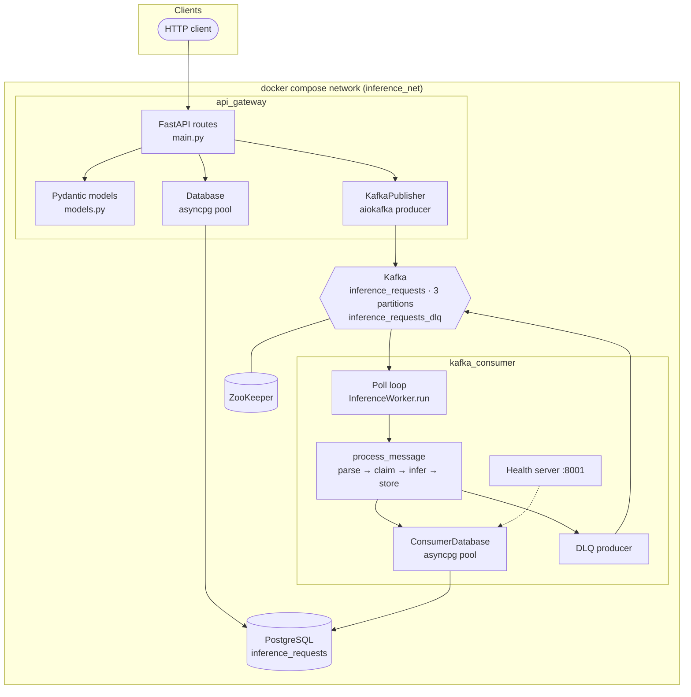
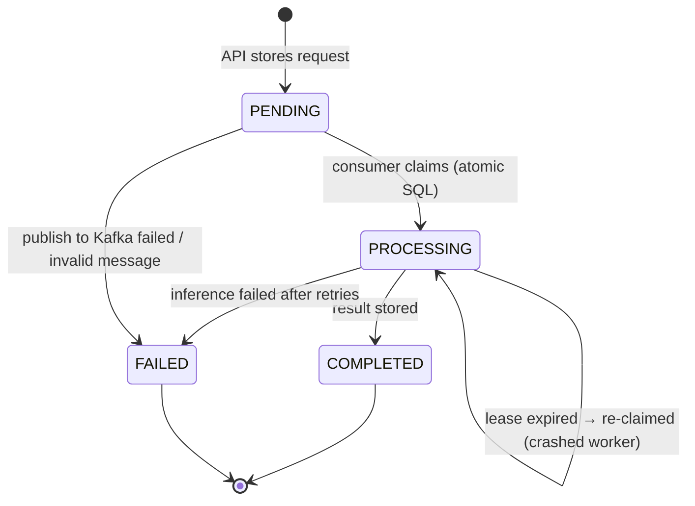
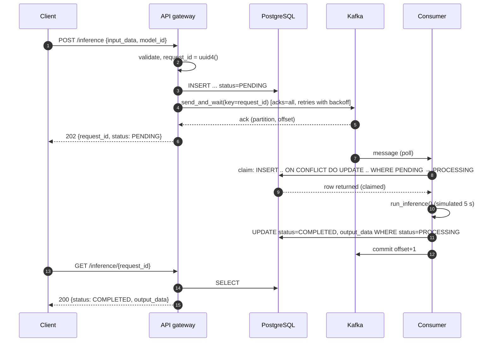
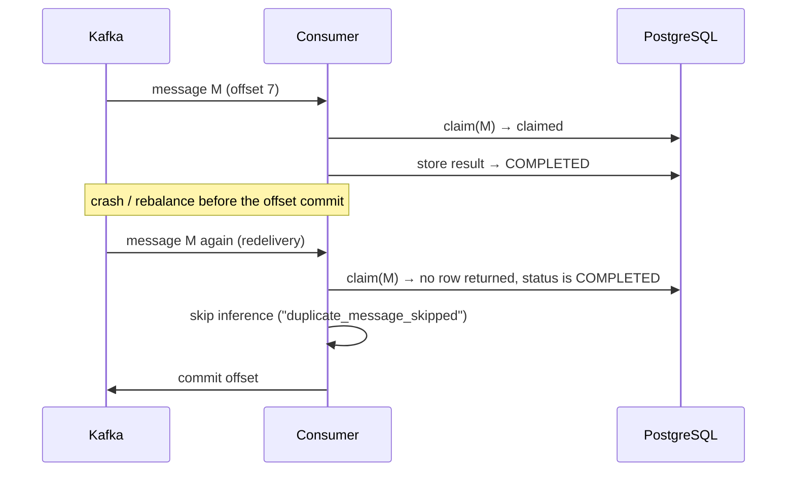
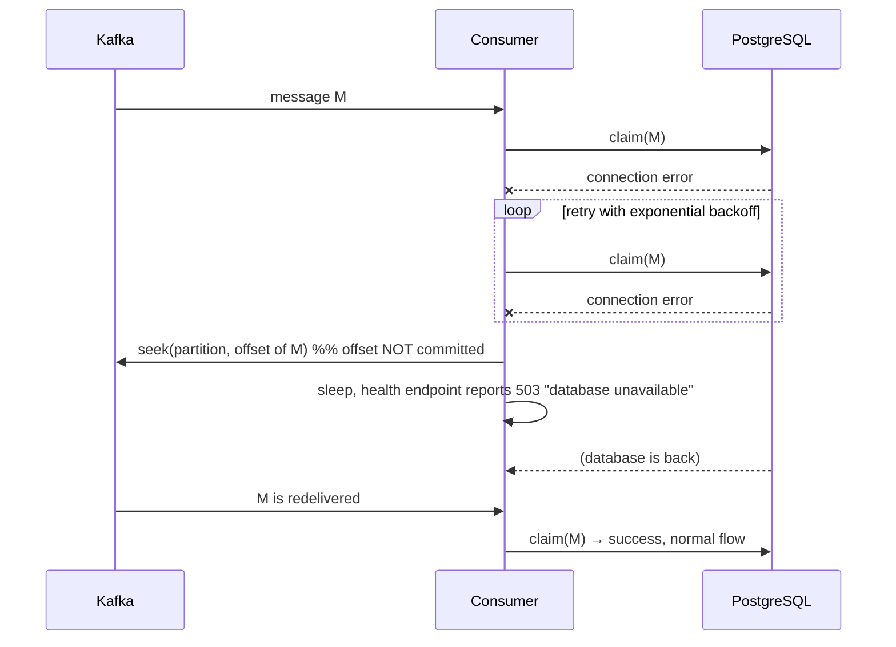
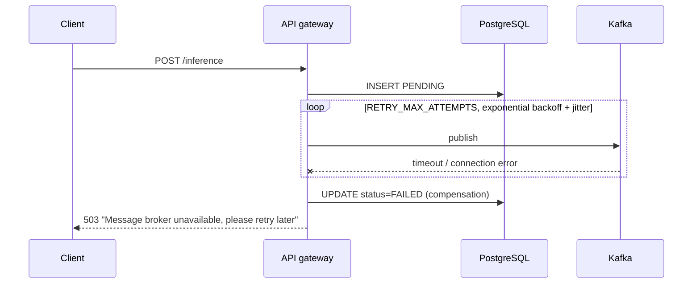
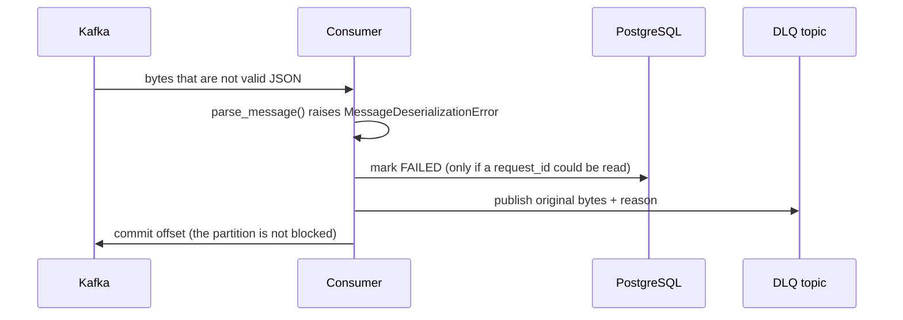

# Architecture

This document goes deeper than the [README](README.md): component responsibilities, data model,
sequence diagrams for every important path, delivery guarantees, scalability and the trade-offs
that were made on purpose.

## 1. Context and goals

| Goal | How the design achieves it |
|------|----------------------------|
| Fast API regardless of model latency | The gateway never runs inference; it persists, publishes and returns `202` |
| Absorb bursts | Kafka buffers requests durably; consumers drain at their own speed |
| Independent scaling | API replicas scale with request rate, consumers with inference load (bounded by partition count) |
| No lost work | `acks=all`, manual offset commits after processing, redelivery on failure |
| No double work | Idempotent consumer using an atomic SQL claim |
| Debuggability | JSON logs with a correlation id that follows the request across services |

## 2. Component view



## 3. Data model

```sql
CREATE TABLE inference_requests (
    request_id    TEXT PRIMARY KEY,                       -- UUID4 generated by the gateway
    model_id      TEXT NOT NULL DEFAULT 'default_model',
    input_data    TEXT NOT NULL,
    output_data   TEXT,
    status        TEXT NOT NULL DEFAULT 'PENDING'
                  CHECK (status IN ('PENDING','PROCESSING','COMPLETED','FAILED')),
    error_message TEXT,
    attempts      INTEGER NOT NULL DEFAULT 0,             -- how many times a worker claimed it
    created_at    TIMESTAMPTZ NOT NULL DEFAULT now(),
    updated_at    TIMESTAMPTZ NOT NULL DEFAULT now(),     -- doubles as the processing lease timestamp
    completed_at  TIMESTAMPTZ
);
CREATE INDEX idx_inference_requests_status ON inference_requests (status);
```

`request_id` is `TEXT` (not `UUID`) so that `GET /inference/<anything>` can answer `404` instead of a
cast error. The schema is created by `db/init.sql` on a fresh volume **and** by both services on
start-up (`CREATE TABLE IF NOT EXISTS` under a PostgreSQL advisory lock so the two cannot race).

### State machine



`COMPLETED` and `FAILED` are terminal: no SQL statement ever moves a row out of them.

## 4. Message contract

Topic `inference_requests` (3 partitions by default), key = `request_id` (UTF-8), value = JSON:

```json
{"request_id": "3f0c1f0e-…", "input_data": "…", "model_id": "resnet50", "timestamp": 1762419421.318}
```

Header `correlation_id` carries the HTTP correlation id. Dead-letter topic `inference_requests_dlq`
carries the original bytes plus headers `dead_letter_reason` and `correlation_id`.

## 5. Sequence diagrams

### 5.1 Happy path



### 5.2 Duplicate delivery (idempotency)



### 5.3 Database outage in the consumer



### 5.4 Kafka outage in the gateway



### 5.5 Poison message → dead-letter topic



## 6. Delivery guarantees

| Hop | Guarantee | Mechanism |
|-----|-----------|-----------|
| Client → API | `202` means the request is persisted **and** acknowledged by Kafka | DB insert + `send_and_wait`, `acks=all` |
| API → Kafka | No loss, no producer duplicates | `acks=all`, `enable_idempotence=True`, retries |
| Kafka → consumer | **At-least-once** | `enable_auto_commit=False`, commit after processing |
| Consumer → DB | **Effectively-once effects** | atomic claim + guarded updates (`WHERE status='PROCESSING'`) |
| Ordering | Per request | Same key → same partition |

Why not exactly-once with Kafka transactions? The side effect lives in PostgreSQL, not Kafka, so
Kafka transactions cannot cover it. Idempotency at the sink is the standard, robust answer.

## 7. Failure matrix

| Failure | Detection | Outcome |
|---------|-----------|---------|
| Gateway crashes after DB insert, before publish | – | `PENDING` row without message (see §9); API clients can retry the POST |
| Consumer crashes during inference | offset uncommitted | Redelivered; `PROCESSING` lease expires after `PROCESSING_LEASE_SECONDS`, then re-claimed |
| Consumer crashes after storing the result | offset uncommitted | Redelivered; claim finds `COMPLETED` → skipped |
| Two consumers get the same message (rebalance) | atomic claim | One wins, the other sees `IN_PROGRESS` and retries later |
| Kafka broker restarts | client reconnect + retries | Producer/consumer reconnect automatically; health turns `503` meanwhile |
| PostgreSQL restarts | `asyncpg` errors → retry/backoff | API answers `503`; consumer redelivers (§5.3) |
| Invalid message | parse error | DLQ + `FAILED` row |
| Simulated model failure | `InferenceError` | `INFERENCE_MAX_ATTEMPTS` tries, then `FAILED` + DLQ copy |

## 8. Scalability

* **Consumers**: parallelism = `min(partitions, replicas)`. `docker compose up -d --scale kafka_consumer=3` gives one consumer per partition; increase `KAFKA_TOPIC_PARTITIONS` for more.
* **API**: stateless; run several replicas behind a load balancer. The asyncpg pool (max 10) and a single producer per process keep resource use bounded.
* **PostgreSQL**: primary-key lookups and single-row updates; the `status` index supports operational queries. Read replicas can serve `GET` if needed.
* **Back-pressure**: when consumers fall behind, requests simply queue in Kafka (lag grows) while the API stays responsive.
* **Benchmarking**: `scripts/benchmark.py` measures accept latency, submit throughput and end-to-end throughput; compare 1 vs 3 consumers.

## 9. Trade-offs and future improvements

1. **Dual write (PostgreSQL then Kafka).** A failed publish is compensated by marking the row `FAILED`. A process crash between the two steps can leave a `PENDING` row. Fix: transactional **outbox** table drained by a relay, or a periodic sweeper that re-publishes `PENDING` rows older than N minutes (safe because the consumer is idempotent).
2. **One message at a time per consumer.** Simple and keeps offset handling trivial. For I/O-bound models add bounded concurrency with per-partition ordered commits.
3. **Lease-based recovery** assumes inference finishes within `PROCESSING_LEASE_SECONDS`; set it above the slowest expected model call, or add a heartbeat that refreshes `updated_at`.
4. **Retries inside the consumer** block its partition. Production systems usually add retry topics with delays and a DLQ re-drive tool.
5. **Single broker / ZooKeeper** for local development. Production: ≥ 3 brokers, `replication.factor=3`, `min.insync.replicas=2`, KRaft or managed Kafka.
6. **Observability**: add Prometheus metrics (consumer lag, inference duration, retry counters) and OpenTelemetry traces; correlation ids already make logs joinable.
7. **Schema evolution**: introduce Schema Registry (Avro/Protobuf) and a `schema_version` field.
8. **Security**: authentication (JWT/OIDC), rate limiting, TLS/SASL for Kafka, secrets from a vault, network policies.
