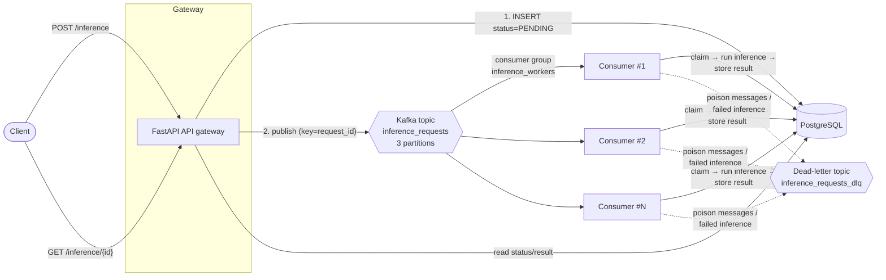
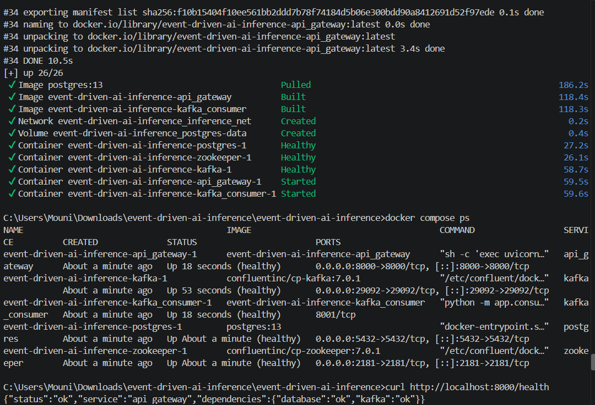
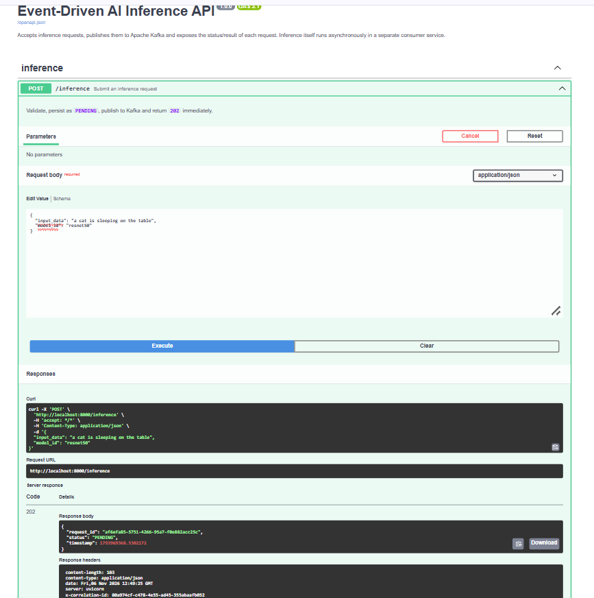
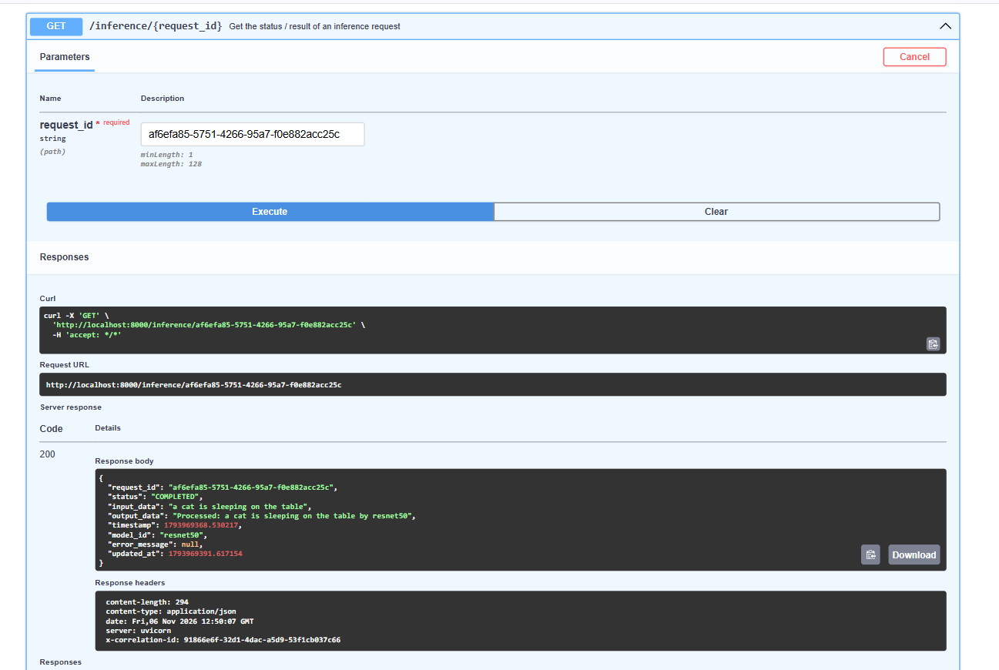
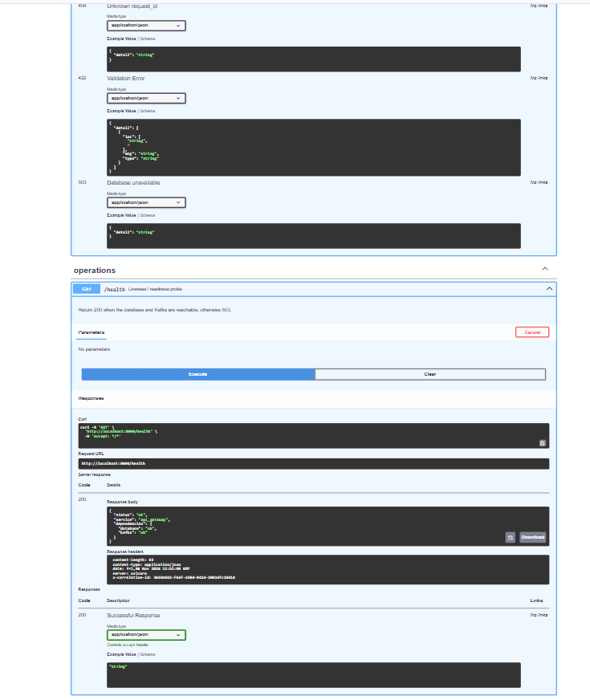
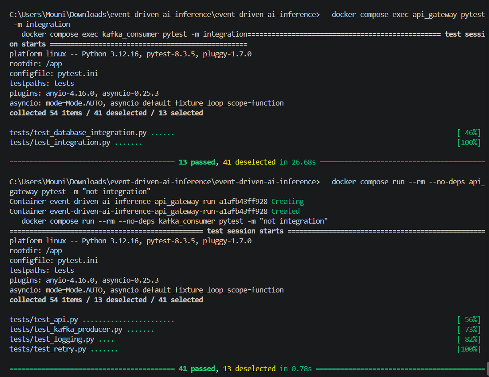

# Event-Driven AI Inference Service

A scalable, event-driven microservice that serves **asynchronous AI inference** with
**FastAPI**, **Apache Kafka**, and **PostgreSQL**. The API accepts a request, stores it,
publishes it to Kafka and answers `202 Accepted` right away. A separate, horizontally
scalable **consumer** performs the (simulated) inference and stores the result, which clients
read back with `GET /inference/{request_id}`.

```
client ──POST /inference──▶ FastAPI ──▶ PostgreSQL (PENDING)
                              │
                              └──publish──▶ Kafka ──▶ consumer group ──▶ PostgreSQL (PROCESSING → COMPLETED/FAILED)
client ──GET /inference/{id}─▶ FastAPI ◀── reads status + result from PostgreSQL
```

**Highlights**

| Area | What is implemented |
|------|--------------------|
| API | FastAPI + Pydantic v2 validation, `202 Accepted`, `404`, `422`, `503`, correlation IDs, auto-generated OpenAPI docs |
| Messaging | `aiokafka` producer (`acks=all`, idempotent), consumer group, manual offset commits, at-least-once delivery, **dead-letter topic** |
| Idempotency | One atomic SQL statement (`INSERT … ON CONFLICT DO UPDATE … WHERE`) lets exactly one worker claim a request; duplicates are skipped |
| Resilience | Exponential backoff + jitter for DB writes and Kafka production, redelivery on DB outage, graceful shutdown, `restart: unless-stopped` |
| Observability | JSON structured logs with `correlation_id` and per-event fields, `/health` on **both** services |
| Delivery | Multi-stage, non-root Dockerfiles, Compose with health-check-based start order, every setting configurable through env vars |
| Quality | 99 unit tests + real-database and end-to-end integration tests, runnable inside the containers |

---

## Table of contents

1. [Quick start](#quick-start)
2. [API documentation](#api-documentation)
3. [Architecture overview](#architecture-overview)
4. [Design choices](#design-choices)
5. [Configuration](#configuration)
6. [Testing](#testing)
7. [Screenshots / demo](#screenshots--demo)
8. [Scaling and benchmarking](#scaling-and-benchmarking)
9. [Project structure](#project-structure)
10. [Troubleshooting](#troubleshooting)
11. [Known limitations and future work](#known-limitations-and-future-work)

---

## Quick start

**Prerequisites:** Docker Engine 20.10+ with the Compose plugin (`docker compose`) or
`docker-compose` 1.29+, and ~3 GB of free RAM for Kafka + ZooKeeper.

```bash
# 1. Clone
git clone https://github.com/prabhasupriya/Build-a-Scalable-Event-Driven-AI-Inference-Service-with-FastAPI-and-Apache-Kafka.git 
cd Build-a-Scalable-Event-Driven-AI-Inference-Service-with-FastAPI-and-Apache-Kafka

# 2. Configure (optional - every variable has a working default in docker-compose.yml)
cp .env.example .env

# 3. Build and start everything (ZooKeeper, Kafka, PostgreSQL, API gateway, consumer)
docker compose up --build -d

# 4. Wait until all services are healthy (about 30-60 s on first start)
docker compose ps

# 5. Smoke test
curl http://localhost:8000/health
```

`docker-compose up --build -d` works as well. Services start in dependency order using
health checks: ZooKeeper → Kafka → PostgreSQL → API gateway / consumer.
The topics (`inference_requests` with 3 partitions, and the dead-letter topic) and the
database schema are created automatically on start-up - no manual steps.

| URL | Description |
|-----|-------------|
| http://localhost:8000/docs | Swagger UI (interactive API docs) |
| http://localhost:8000/redoc | ReDoc |
| http://localhost:8000/health | API gateway health |
| `localhost:29092` | Kafka (for tools running on your host) |
| `localhost:5432` | PostgreSQL (`user` / `password` / `inference_db` by default) |

Try the full flow with the bundled demo script, or follow the curl examples below:

```bash
./scripts/demo.sh
```

Useful commands:

```bash
docker compose logs -f api_gateway kafka_consumer   # structured JSON logs
docker compose up -d --scale kafka_consumer=3       # run 3 consumer replicas
docker compose down -v                              # stop and delete all data
```

---

## API documentation

Base URL: `http://localhost:8000` · Content type: `application/json` ·
Interactive docs: `/docs` · Machine-readable spec: [`docs/openapi.json`](docs/openapi.json) ·
Postman: [`docs/postman_collection.json`](docs/postman_collection.json)

Every response carries an `X-Correlation-ID` header. Send your own to trace a request through
the logs of the gateway, Kafka and the consumer; otherwise one is generated.

### `POST /inference` - submit a request

| Field | Type | Required | Rules |
|-------|------|----------|-------|
| `input_data` | string | yes | 1-10 000 characters after trimming (text, or a URL such as an image link) |
| `model_id` | string | no | default `default_model`; letters, digits, `. _ : / -`, max 128 chars |

```bash
curl -i -X POST http://localhost:8000/inference \
  -H "Content-Type: application/json" \
  -d '{"input_data": "A photo of a cat on a sofa", "model_id": "resnet50"}'
```

**`202 Accepted`**

```json
{
  "request_id": "3f0c1f0e-6f0e-4b53-8e55-0f6a7c1f2a9b",
  "status": "PENDING",
  "timestamp": 1762419421.318
}
```

| Status | Meaning |
|--------|---------|
| `202` | Stored as `PENDING` and published to Kafka |
| `422` | Invalid body: missing/empty `input_data`, too long, bad `model_id`, malformed JSON (client error) |
| `503` | PostgreSQL or Kafka unavailable after retries (server error, safe to retry) |
| `500` | Unexpected server error (logged with the correlation id) |

### `GET /inference/{request_id}` - read status and result

```bash
curl http://localhost:8000/inference/3f0c1f0e-6f0e-4b53-8e55-0f6a7c1f2a9b
```

**`200 OK`** - right after submission (`PENDING`, later `PROCESSING`):

```json
{
  "request_id": "3f0c1f0e-6f0e-4b53-8e55-0f6a7c1f2a9b",
  "status": "PENDING",
  "input_data": "A photo of a cat on a sofa",
  "output_data": null,
  "timestamp": 1762419421.318,
  "model_id": "resnet50",
  "error_message": null,
  "updated_at": 1762419421.318
}
```

**`200 OK`** - about 5 seconds later (the simulated inference time):

```json
{
  "request_id": "3f0c1f0e-6f0e-4b53-8e55-0f6a7c1f2a9b",
  "status": "COMPLETED",
  "input_data": "A photo of a cat on a sofa",
  "output_data": "Processed: A photo of a cat on a sofa by resnet50",
  "timestamp": 1762419421.318,
  "model_id": "resnet50",
  "error_message": null,
  "updated_at": 1762419426.402
}
```

**`404 Not Found`** - unknown id: `{"detail": "Inference request not found"}`
**`503`** - database unavailable.

Status lifecycle: `PENDING → PROCESSING → COMPLETED | FAILED`.
Any input containing `__fail__` (configurable) makes the simulated model fail, which
produces `status: "FAILED"` plus an `error_message` - handy for demos and tests.

### `GET /health` - readiness probe

```bash
curl http://localhost:8000/health
# {"status":"ok","service":"api_gateway","dependencies":{"database":"ok","kafka":"ok"}}
```

Returns `200` when PostgreSQL and Kafka are reachable, otherwise `503` with
`"status": "degraded"`. The consumer exposes the same contract on its own port
(`GET :8001/health`, used by its Docker health check, not published to the host by default):

```bash
docker compose exec kafka_consumer curl -s localhost:8001/health
```

---

## Architecture overview



| Component | Responsibility |
|-----------|----------------|
| **API gateway** (`api_gateway/`) | Validates input, generates the `request_id` (UUID4), persists `PENDING`, publishes to Kafka, returns `202`. Serves results from PostgreSQL. Never runs inference. |
| **Kafka + ZooKeeper** | Durable, partitioned log that decouples the gateway from the workers and absorbs traffic bursts. Messages are keyed by `request_id`. |
| **Consumer** (`kafka_consumer/`) | Member of the `inference_workers` group. Claims a request, runs the simulated inference, stores `COMPLETED`/`FAILED`, then commits the offset. Exposes `/health`. |
| **PostgreSQL** | Source of truth for request state (`inference_requests` table) and the idempotency guard. |
| **Dead-letter topic** | Receives messages that can never succeed (invalid JSON, schema violations, permanently failing inference) for later inspection. |

Request flow:

1. `POST /inference` → Pydantic validation → `request_id` → row inserted as `PENDING`.
2. Message `{request_id, input_data, model_id, timestamp}` published to `inference_requests` (acknowledged by all in-sync replicas) → `202` returned.
3. A consumer claims the row (`PROCESSING`), simulates inference (5 s), writes output and `COMPLETED`, then commits the Kafka offset.
4. `GET /inference/{request_id}` returns the current state at any time.

More detail, including sequence diagrams for the success, duplicate, outage and poison-message
paths, is in [`ARCHITECTURE.md`](ARCHITECTURE.md).

---

## Design choices

### Why Kafka and an asynchronous flow?
Inference is slow and bursty. Running it inside the HTTP handler would tie up a worker per
request and collapse under load. Publishing to Kafka lets the API answer in milliseconds while
a pool of consumers drains the backlog at its own pace. API and workers scale **independently**:
add partitions + consumer replicas for throughput, add API replicas for request rate.

### Event handling and delivery guarantees
* **Keyed messages** (`key = request_id`): all messages of a request go to one partition, so they stay ordered, and duplicates land on the same consumer.
* **Producer**: `acks=all` + idempotent producer → no loss and no producer-side duplicates.
* **Consumer**: `enable_auto_commit=False`; the offset is committed only **after** the message was fully handled → **at-least-once** delivery. A crash can only cause redelivery, never loss.
* **Idempotent processing** turns at-least-once into effectively-once *effects* (see below).
* **Consumer groups** provide parallelism and fault tolerance: if a worker dies, its partitions are rebalanced to the others.

### Idempotent consumer
The consumer claims a request with a single atomic statement:

```sql
INSERT INTO inference_requests (...) VALUES (..., 'PROCESSING', ...)
ON CONFLICT (request_id) DO UPDATE SET status = 'PROCESSING', attempts = attempts + 1, ...
WHERE status = 'PENDING'
   OR (status = 'PROCESSING' AND updated_at < now() - lease)   -- crashed worker
RETURNING request_id;
```

* Row `COMPLETED`/`FAILED` → no row returned → **duplicate skipped** (inference not run again).
* Row `PENDING` → claimed. Missing row (API write lost) → created and claimed.
* Row `PROCESSING` with a live lease → another worker is on it → retried later.
* Row `PROCESSING` with an expired lease → the worker crashed → safely re-claimed.

Result writes are guarded (`WHERE status = 'PROCESSING'`), so a late duplicate can never overwrite a final state. This is verified against real PostgreSQL, including 10 concurrent claims of the same id (exactly one wins).

### Error handling and resilience

| Failure | Behaviour |
|---------|-----------|
| Invalid request body | `422` with field-level details, logged at `WARNING` |
| PostgreSQL unavailable (API) | Retries with exponential backoff, then `503`; `GET` also returns `503` |
| Kafka unavailable (API) | Retries with exponential backoff, then `503`; the stored row is marked `FAILED` so nothing stays orphaned in `PENDING` |
| Non-retriable Kafka error (e.g. message too large) | Not retried, fails fast |
| PostgreSQL unavailable (consumer) | Retries; if still down the offset is **not** committed and the consumer **seeks back** to redeliver the same message after a pause |
| Malformed message (bad JSON / missing fields) | Logged, row marked `FAILED` when the id is known, message published to the **dead-letter topic**, offset committed (no poison-message loop) |
| Inference error | Retried up to `INFERENCE_MAX_ATTEMPTS`, then row `FAILED` with `error_message` + dead-letter copy |
| Unexpected exception while handling a message | Isolated like a poison message; the worker loop never dies |
| Consumer crash mid-inference | Offset not committed → message redelivered; stale `PROCESSING` lease is re-claimed |
| Dead-letter publish fails | Offset not committed → message retried (never silently dropped) |
| Container receives `SIGTERM` | Graceful shutdown: finish the current message, commit, close connections (`stop_grace_period: 30s`) |

Retries use `delay = min(max_delay, base_delay × 2^(attempt-1))` plus up to 10 % jitter
(`RETRY_MAX_ATTEMPTS`, `RETRY_BASE_DELAY_SECONDS`, `RETRY_MAX_DELAY_SECONDS`). Every retry and
final failure is logged with the operation, attempt number and error.

### Asynchronous patterns
Everything is `async`/`await` end to end: `asyncpg` pool for PostgreSQL, `aiokafka` for Kafka,
`asyncio.sleep` for the simulated model (a blocking `time.sleep` would freeze the event loop and
the health endpoint). The consumer's health server is a ~70-line asyncio TCP server, so the worker
needs no web framework.

### Structured logging
All logs are single-line JSON with `timestamp`, `level`, `service`, `logger`, `message` (an event
name), a **`correlation_id`** propagated from the HTTP header → Kafka message header → consumer,
and event-specific fields:

```json
{"timestamp": "2026-11-06T11:37:01.482+00:00", "level": "INFO", "service": "kafka_consumer", "logger": "app.consumer", "message": "inference_completed", "correlation_id": "6d0b…", "request_id": "3f0c1f0e-…", "duration_ms": 5003.12}
```

Logged events include request receipt, message published/consumed, inference started/completed,
result stored, duplicates skipped, retries (with attempt counters), dead-lettering and all errors
(with tracebacks).

### Security and code quality
* All SQL is parameterised (verified by a test that stores a `DROP TABLE` payload as plain text).
* Input is bounded and validated; error responses never leak stack traces.
* Containers run as a non-root user; no secrets are baked into images. Credentials come from the environment (`.env` is git-ignored; `.env.example` holds dummy values).
* No authentication, as permitted by the task scope.
* Type hints, small single-purpose modules, dependency injection through `app.state` for easy testing.

### Containerisation
Both Dockerfiles are **multi-stage**: a builder stage creates the virtualenv, and the slim runtime
image copies only that venv (no compilers, no pip cache), runs as a non-root user, and starts the
process as PID 1 so it receives `SIGTERM`. The requirements layer is cached until dependencies
change. Compose uses health checks (`pg_isready`, `kafka-topics`, `curl /health`) with
`depends_on: condition: service_healthy`, a dedicated network, and a named volume for PostgreSQL.

---

## Configuration

All configuration is environment-driven (see [`.env.example`](.env.example)); nothing is hard-coded.

| Variable | Default | Used by | Description |
|----------|---------|---------|-------------|
| `FASTAPI_HOST` / `FASTAPI_PORT` | `0.0.0.0` / `8000` | api | Bind address / port |
| `KAFKA_BOOTSTRAP_SERVERS` | `kafka:9092` | both | Broker list |
| `KAFKA_TOPIC_REQUESTS` | `inference_requests` | both | Request topic |
| `KAFKA_TOPIC_DLQ` | `inference_requests_dlq` | consumer | Dead-letter topic |
| `KAFKA_CONSUMER_GROUP_ID` | `inference_workers` | consumer | Consumer group |
| `KAFKA_TOPIC_PARTITIONS` / `KAFKA_TOPIC_REPLICATION_FACTOR` | `3` / `1` | both | Used when creating topics |
| `DB_HOST` `DB_PORT` `DB_USER` `DB_PASSWORD` `DB_NAME` | `postgres` `5432` `user` `password` `inference_db` | both | PostgreSQL connection |
| `LOG_LEVEL` | `INFO` | both | `DEBUG` / `INFO` / `WARNING` / `ERROR` |
| `CONSUMER_HEALTH_PORT` | `8001` | consumer | Health endpoint port |
| `INFERENCE_SIMULATED_SECONDS` | `5` | consumer | Simulated model latency |
| `INFERENCE_MAX_ATTEMPTS` | `3` | consumer | Inference attempts before `FAILED` |
| `INFERENCE_FAILURE_MARKER` | `__fail__` | consumer | Input substring that forces a simulated failure |
| `PROCESSING_LEASE_SECONDS` | `120` | consumer | When a `PROCESSING` row counts as abandoned |
| `RETRY_MAX_ATTEMPTS` | `5` | both | Retries for DB / Kafka calls |
| `RETRY_BASE_DELAY_SECONDS` / `RETRY_MAX_DELAY_SECONDS` | `0.5` / `10` | both | Backoff parameters |

---

## Testing

Both service images contain their tests, so everything runs **inside the containers**.

### Unit tests (no Kafka/PostgreSQL needed)

```bash
docker compose run --rm --no-deps api_gateway pytest -m "not integration"
docker compose run --rm --no-deps kafka_consumer pytest -m "not integration"
```

| Service | Covers |
|---------|--------|
| `api_gateway/tests/test_api.py` | `request_id` generation, Kafka message construction, input validation, `202/404/422/503` paths, correlation IDs, health |
| `api_gateway/tests/test_kafka_producer.py` | Message key/headers, retry with backoff, give-up on permanent errors, ping |
| `api_gateway/tests/test_retry.py`, `test_logging.py` | Backoff maths, JSON log format |
| `kafka_consumer/tests/test_consumer.py` | Message parsing, inference wrapper, **idempotency**, DLQ routing, DB outage handling, offset-commit semantics, correlation ids |
| `kafka_consumer/tests/test_health.py` | Health logic and the HTTP endpoint (200 → 503) |

### Integration / end-to-end tests (need the stack running)

```bash
docker compose up --build -d                                   # if not running yet
docker compose exec api_gateway     pytest -m integration       # E2E + gateway SQL
docker compose exec kafka_consumer  pytest -m integration       # idempotent SQL + Kafka consume
```

| Test file | Verifies |
|-----------|----------|
| `api_gateway/tests/test_integration.py` | **POST → Kafka → consumer → PostgreSQL → GET** end to end, messages published straight to Kafka, result persisted in PostgreSQL, duplicate delivery processed once, `FAILED` flow, `404`, `422` |
| `api_gateway/tests/test_database_integration.py` | Gateway SQL against real PostgreSQL (incl. SQL-injection attempt) |
| `kafka_consumer/tests/test_integration.py` | Atomic claim semantics against real PostgreSQL (10 concurrent claims → 1 winner, lease expiry), real Kafka consumption, duplicates, poison message → dead-letter topic |

Integration tests skip themselves with a clear message when the stack is not reachable.
Shortcuts: `make test-unit`, `make test-integration`, `make test`.

**Running locally without Docker** (Python 3.12):

```bash
python -m venv .venv && source .venv/bin/activate
pip install -r requirements.txt pytest pytest-asyncio httpx
(cd api_gateway && pytest -m "not integration")
(cd kafka_consumer && pytest -m "not integration")
```

---

## Screenshots / demo







Run `./scripts/demo.sh` against the running stack: it checks health, submits a request, polls
until `COMPLETED`, and demonstrates the `404`, `422` and `FAILED` paths. Place the captured
screenshots in [`docs/screenshots/`](docs/screenshots/):

| File | Shows |
|------|-------|
| `docs/screenshots/01-docker-compose-ps.png` | `docker compose ps` with all services healthy |
| `docs/screenshots/02-post-inference.png` | `POST /inference` → `202 Accepted` |
| `docs/screenshots/03-get-result.png` | `GET /inference/{id}` going `PENDING` → `COMPLETED` |
| `docs/screenshots/04-swagger-ui.png` | Swagger UI at `/docs` |
| `docs/screenshots/05-structured-logs.png` | JSON logs from `docker compose logs` showing one correlation id across both services |

---

## Scaling and benchmarking

```bash
docker compose up -d --scale kafka_consumer=3     # one consumer per partition
python3 scripts/benchmark.py --requests 60 --concurrency 20
```

[`scripts/benchmark.py`](scripts/benchmark.py) (standard library only) reports **accept latency**
(stays in milliseconds regardless of inference time), **submit throughput** and **end-to-end
throughput**. With a 5 s simulated model, one consumer handles ~0.2 requests/s, three consumers
~0.6/s - throughput scales with `min(partitions, replicas)` while the API stays fast.

---

## Project structure

```
.
├── docker-compose.yml          # ZooKeeper, Kafka, PostgreSQL, api_gateway, kafka_consumer
├── .env.example                # all environment variables with dummy values
├── requirements.txt            # convenience: installs both services' deps for local dev
├── README.md  ARCHITECTURE.md
├── Makefile                    # up / down / test shortcuts
├── db/init.sql                 # schema bootstrap (apps also create it if missing)
├── docs/                       # openapi.json, Postman collection, screenshots
├── scripts/                    # demo.sh, benchmark.py
├── api_gateway/
│   ├── Dockerfile  requirements.txt  pytest.ini
│   ├── app/  main.py  models.py  database.py  kafka_producer.py  config.py  retry.py  logging_config.py
│   └── tests/ test_api.py  test_kafka_producer.py  test_retry.py  test_logging.py
│              test_integration.py  test_database_integration.py
└── kafka_consumer/
    ├── Dockerfile  requirements.txt  pytest.ini
    ├── app/  consumer.py  database.py  health.py  config.py  retry.py  logging_config.py
    └── tests/ test_consumer.py  test_health.py  test_retry.py  test_logging.py  test_integration.py
```

---

## Troubleshooting

| Symptom | Fix |
|---------|-----|
| Port 5432 / 8000 / 2181 already in use | Stop the local service, or change the host port mapping in `docker-compose.yml` / `FASTAPI_PORT` in `.env` |
| `api_gateway` restarts at first start | Kafka needs up to a minute; the gateway retries with backoff and Compose waits for the Kafka health check |
| Stale data after changing credentials | `docker compose down -v` (PostgreSQL only applies credentials to a fresh volume) |
| Requests stay `PENDING` | `docker compose logs kafka_consumer`; check `docker compose ps` for the consumer's health |
| Only one consumer is busy when scaled | You can run at most `KAFKA_TOPIC_PARTITIONS` useful consumers |

---

## Known limitations and future work

* **Dual write**: the API writes to PostgreSQL and then to Kafka. A failed publish is compensated (row marked `FAILED`), but a process crash in between could leave a `PENDING` row. A transactional **outbox** (or a sweeper job that republishes old `PENDING` rows) closes this gap; the idempotent consumer already makes republishing safe.
* Each consumer handles one message at a time; scale with partitions/replicas (or add bounded concurrency per consumer).
* The simulated model can be replaced by a real one inside `run_inference()` without touching the pipeline.
* No authentication/authorisation (out of scope by the task statement); add an API gateway/OIDC for production.
* Single-broker Kafka for development; production needs replication factor ≥ 3 and `min.insync.replicas=2`.
* Next steps: Prometheus metrics (`/metrics`), OpenTelemetry tracing, Schema Registry (Avro/Protobuf), retry topics with delay, Kubernetes manifests/Helm chart.


## youtude video
[watch here]()